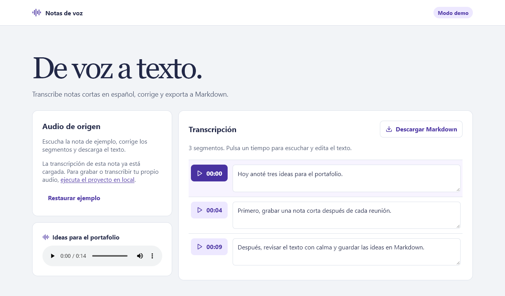

# Notas de voz

Graba o carga una nota de hasta tres minutos, transcríbela en español y corrige el texto mientras escuchas cada fragmento. Descarga la revisión como Markdown con las marcas de tiempo.

[Abrir la demo interactiva](https://humiumii.github.io/notas-de-voz/)



GitHub Pages sirve la interfaz con una nota sintética y su transcripción revisada. En **Modo demo** puedes reproducir, saltar entre fragmentos, editar y descargar. Para usar tu micrófono o transcribir otro archivo, inicia la web y la API en tu equipo.

## Modo local

Necesitas Node.js 24, Python 3.12 y FFmpeg 6.1 o posterior disponible en el `PATH`.

```sh
git clone https://github.com/Humiumii/notas-de-voz.git
cd notas-de-voz
npm ci
python -m venv .venv
```

En Windows, usa `py -3.12 -m venv .venv` si el comando `python` apunta a otra versión. Activa el entorno con `.\.venv\Scripts\Activate.ps1` en PowerShell o con `source .venv/bin/activate` en macOS y Linux. En esa terminal, instala e inicia la API.

```sh
python -m pip install -r requirements.txt
python -m uvicorn api.main:app --host 127.0.0.1 --port 18765
```

En otra terminal, desde la raíz del repositorio, inicia Vite.

```sh
npm run dev
```

1. Abre [la web local](http://127.0.0.1:5173/). Pulsa **Usar nota de ejemplo** y luego **Transcribir** para probar la API.
2. Para grabar, pulsa **Grabar audio**, acepta el permiso y detén la captura. También puedes cargar un MP3, WAV, M4A o un archivo compatible con tu navegador. El límite es de 3 minutos y 32 MB.
3. Pulsa **Transcribir**, selecciona un tiempo para escuchar desde ese punto, edita el texto y pulsa **Descargar Markdown**.

Faster-Whisper usa el modelo multilingüe `base` en CPU con cuantización INT8 y el idioma fijado en español. La primera transcripción puede requerir Internet para descargar el modelo. Si tienes un modelo compatible en disco, indica su ruta con la variable de entorno `WHISPER_MODEL` antes de iniciar la API. Vite reenvía `/api` a `127.0.0.1:18765`. Puedes cambiar el destino mediante `NOTAS_API_URL`.

La API procesa el audio en el equipo donde se ejecuta. Las cargas temporales se cierran al terminar de leerlas. La web mantiene el texto en memoria hasta que lo descargues o cierres la página. El repositorio incluye únicamente el audio sintético y el texto de ejemplo.

## Sincronización

FastAPI recibe el audio en `POST /api/transcribir`. FFmpeg lo convierte a mono de 16 kHz y Faster-Whisper devuelve segmentos con `start`, `end` y `text`. Los tiempos se expresan en segundos desde el inicio. Al pulsar un segmento, React asigna `start` a `audio.currentTime` e inicia la reproducción. El evento `timeupdate` permite resaltar el segmento bajo el cursor. Las correcciones modifican únicamente `text`. La descarga incluye el texto corregido y el rango original de cada segmento, con precisión de milisegundos.

## Verificación

```sh
python -m pip install -r requirements-dev.txt
python -m pytest -q
npm run build
npm run build:demo
npm run preview
```

Las pruebas de la API usan un motor simulado y FFmpeg real. Cubren la nota de ejemplo, M4A, un archivo inválido, una carga vacía, el límite de duración y un fallo del motor. Para verificar manualmente el caso de permiso denegado, bloquea el micrófono para el sitio local y pulsa **Grabar audio**. La web explica qué pasó y mantiene disponible la carga de archivos.

`npm run build:demo` genera la versión estática con el ejemplo precargado. El flujo de GitHub Actions la publica en Pages tras cambios en `main`.
